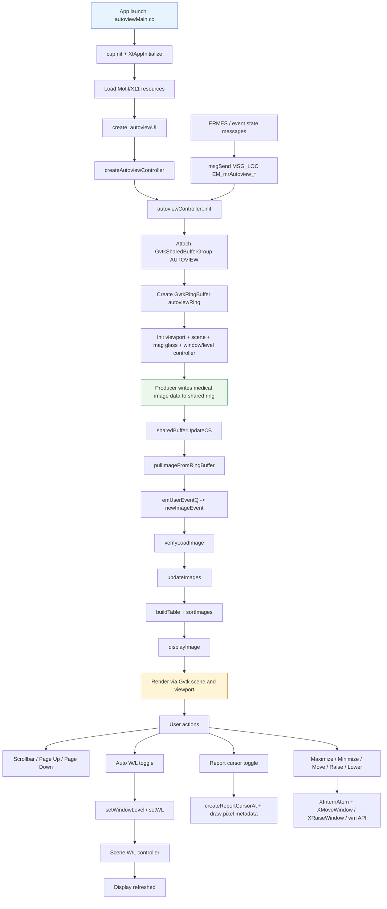
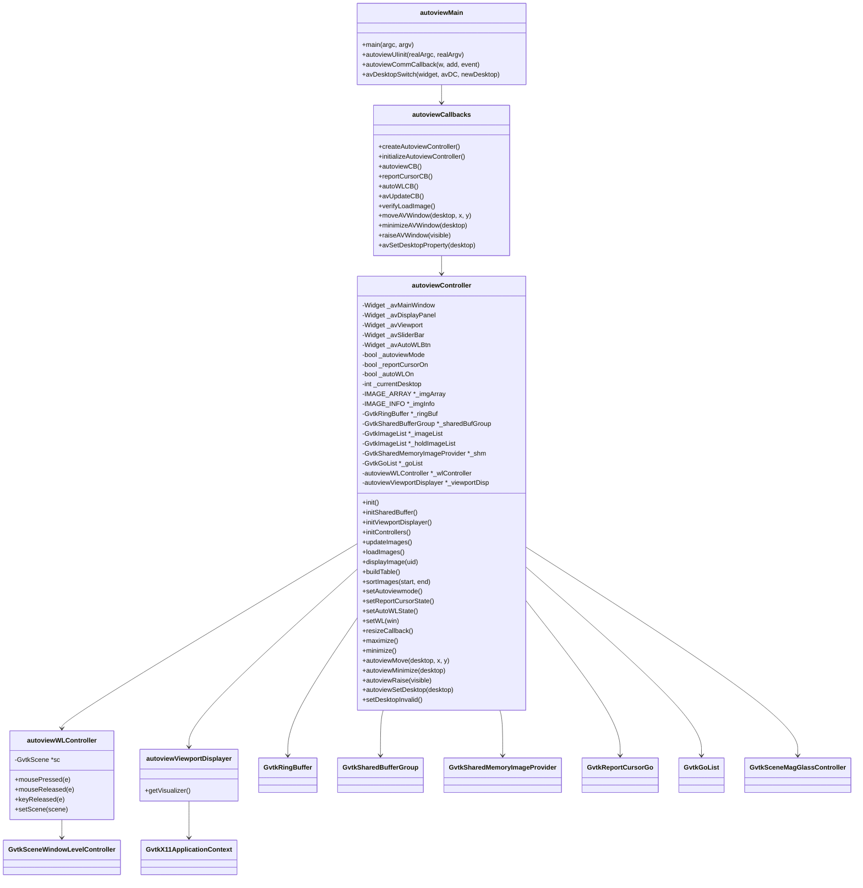
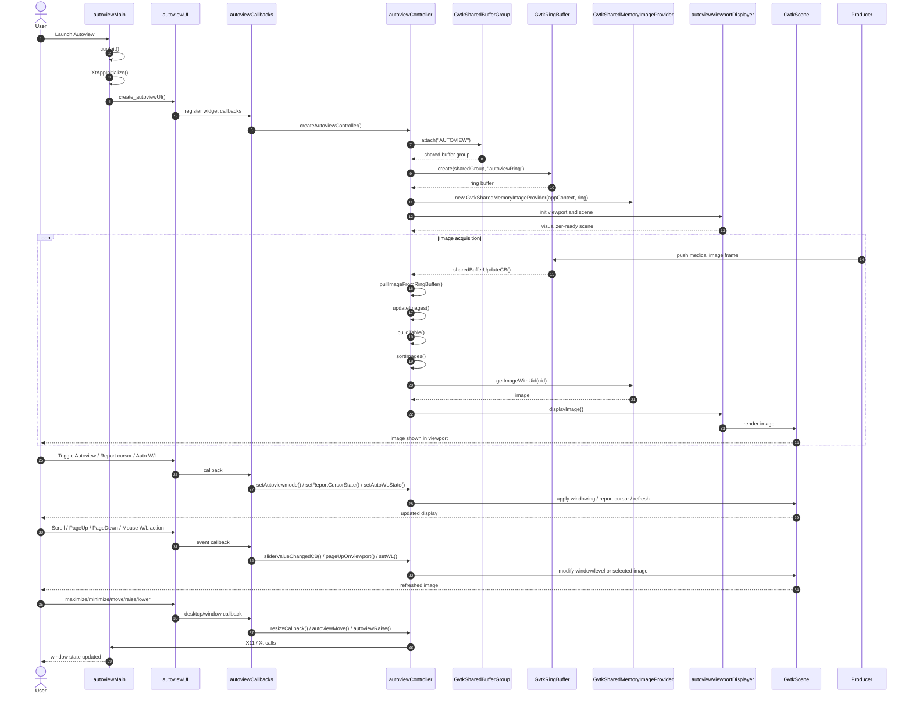

# Autoview application summary

## 1) What this app is

Autoview is a native GE-hosted image review window for viewing medical image frames that are produced and published into a shared image ring buffer. The app is built as a C++ Motif/X11 application and is intended to display the current image stream, allow image navigation, and provide window/level and cursor inspection controls.

The application entry point is in [autoviewMain.cc](autoviewMain.cc), with controller logic in [autoviewController.cc](autoviewController.cc) and UI registration in [autoviewCallbacks.cc](autoviewCallbacks.cc). The resource layout comes from [autoviewUI.rf](autoviewUI.rf), and the main view is created by [autoviewUI.cc](autoviewUI.cc).

## 2) High-level purpose

Autoview serves as a local image display pane for scan operators and workflow users. It is not a web app; it is a native desktop viewer that:

- subscribes to a shared image ring and listens for new image events;
- displays the latest image in Autoview mode;
- allows review of alternate images in a sequence;
- supports W/L adjustment, report cursor inspection, and page/scroll navigation;
- manages desktop/window placement behavior (maximize, minimize, move, raise/lower);
- integrates with the GE messaging/event framework and X11 desktop behavior.

## 3) Major use cases

### Use case 1: Monitor live image stream
- The app connects to a shared image buffer called `AUTOVIEW`.
- It creates a `GvtkRingBuffer` named `autoviewRing` and reads images from that ring.
- When new data arrives, the update callback triggers and the current image is refreshed.

### Use case 2: Review or browse image set
- The image list is kept in order and sorted by series and image number.
- The scrollbar lets the user browse older/newer frames.
- Keyboard navigation supports page up/down and arrow keys.

### Use case 3: Toggle Autoview mode on/off
- Autoview mode shows the live or latest displayed image.
- When switched off, the app enters a review/hold mode and allows comparison or manual update behavior.

### Use case 4: Report cursor inspection
- The app can overlay a report cursor.
- It reads the pixel returned by the scene and draws a floating report label containing coordinate data and pixel value.

### Use case 5: Auto window/level adjustment
- `Auto W/L` uses the current scene's automatic window/level values.
- Mouse drag or window-level controller actions adjust the displayed image.
- The app can override the current W/L for the selected image.

### Use case 6: Save/reset window/level state
- The UI includes a save W/L toggle, and the controller includes state file persistence methods for reading/writing window-level values.

### Use case 7: Window management / desktop behavior
- The app can move, minimize, raise, or lower itself on the X11 desktop.
- It supports multiple virtual desktops and visual behavior for GRx display pages.
- X11 atoms such as `MoveAutoview`, `MinimizeAutoview`, `RaiseAutoview`, and `LowerAutoview` are used for inter-process control.

## 4) Technology stack

- Native C++ application compiled with GCC/Imake rules in [Makefile](Makefile).
- Xt / X11 / Motif UI toolkit (`Xm*`, `XtAppInitialize`, `XInternAtom`, `XMoveWindow` etc.).
- GE imaging rendering stack: `Gvtk*` classes for image rendering, visualization, scene interaction, shared memory, and ring buffers.
- Shared-memory image provider: `GvtkSharedMemoryImageProvider`, `GvtkRingBuffer`, `GvtkSharedBufferGroup`.
- GE event messaging: `msgSend`, `emUserEventQ`, `EM_USERID`, `EM_USEREVENT`, and ERMES definitions from [em_mrAutoview_ermes.in](../../manifest/packages/ermes-headers/ermes/em_mrAutoview_ermes.in).
- X11 resource files: [autoviewUI.rf](autoviewUI.rf) and [autoview_hardc.rf](autoview_hardc.rf).
- Packaging: installed as `/usr/g/bin/autoview` according to [toProduct.Autoview.linux](toProduct.Autoview.linux).

## 5) Related implementation files and dependencies

The following files are the most relevant for understanding how the app implements each feature:

### Core app lifecycle and startup
- [autoviewMain.cc](autoviewMain.cc) — application entry point, Xt initialization, resource loading, and startup orchestration.
- [autoviewCallbacks.cc](autoviewCallbacks.cc) — all controller callbacks and UI-to-controller wiring.
- [autoviewUI.cc](autoviewUI.cc) — UI construction, widget registration, and application shell creation.
- [autoviewUI.i](autoviewUI.i) — UI interface specification generated by the UI builder.
- [autoviewUI.rf](autoviewUI.rf) — visible control layout, button positions, image viewport size, and default resource values.
- [autoview_hardc.rf](autoview_hardc.rf) — hardcoded labels and strings used by the app.
- [Makefile](Makefile) — build configuration and platform-specific compile flags.

### Feature logic and state management
- [autoviewController.h](autoviewController.h) — central state, image metadata, desktop state, and GVTK objects used by the controller.
- [autoviewController.cc](autoviewController.cc) — main feature implementation: startup init, shared buffer attach, ring consumption, image sort/display, scroll update, report cursor, desktop window management, and W/L logic.
- [autoviewWLController.h](autoviewWLController.h) — window/level interaction controller definition.
- [autoviewWLController.cc](autoviewWLController.cc) — button/mouse/keyboard behavior for W/L adjustment and page navigation.
- [autoviewViewportDisplayer.h](autoviewViewportDisplayer.h) — viewport/displayer abstraction wrapping the visualizer.
- [autoviewViewportDisplayer.cc](autoviewViewportDisplayer.cc) — visualizer retrieval used during display rendering.

### Image and UI support utilities
- [pixelCvt.c](pixelCvt.c) and [pixelCvt.h](pixelCvt.h) — X11 pixel conversion support for custom scan color resources.
- [fontListCvt.c](fontListCvt.c) and [fontListCvt.h](fontListCvt.h) — font-list conversion for Motif/X11 resource handling.

### Shared-memory and event integration
- [autoviewController.cc](autoviewController.cc) — defines the ring buffer creation and access:
  - `GvtkSharedBufferGroup::attach("AUTOVIEW")`
  - `GvtkRingBuffer::create(_sharedBufGroup, "autoviewRing")`
  - `GvtkSharedMemoryImageProvider(_appContext, _ringBuf)`
- [autoviewCallbacks.cc](autoviewCallbacks.cc) — callback triggers such as `sharedBufferUpdateCB`, `verifyLoadImage`, and `registerCallback`.
- [../../manifest/packages/ermes-headers/ermes/em_mrAutoview_ermes.in](../../manifest/packages/ermes-headers/ermes/em_mrAutoview_ermes.in) — message IDs for Autoview status/error conditions.
- [../../manifest/packages/lx-interface/src/host/include/rx/SrxUtilities.h](../../manifest/packages/lx-interface/src/host/include/rx/SrxUtilities.h) — registration/function declarations related to UI and desktop integration.

### Packaging / deployment context
- [toProduct.Autoview.linux](toProduct.Autoview.linux) — package manifest showing the binary and screen resource installation paths.

## 6) External interfaces and APIs called

From the code, the app is dependent on these interfaces:

1. X11 / Xt / Motif
   - `XtAppInitialize`
   - `XInternAtom`
   - `XMoveWindow`, `XRaiseWindow`, `XSync`
   - `Xm*` control management and toggle buttons

2. GE message bus / event manager
   - `msgSend(MSG_LOC, EM_mrAutoview_...)`
   - `emUserEventQ(&autoviewID, &newImageEvent, EM_SETVAL, 1)`

3. GVTK imaging and rendering
   - `GvtkSharedBufferGroup::attach("AUTOVIEW")`
   - `GvtkRingBuffer::create(...)`
   - `GvtkX11ApplicationContext`
   - `GvtkSceneMagGlassController`
   - `GvtkSceneWindowLevelController`
   - `GvtkSharedMemoryImageProvider`
   - `GvtkGoList`, `GvtkReportCursorGo`

4. GE scan resource database
   - `GeXLoadResources(UxDisplay, "autoviewUI.rf", "SCREENSDIR")`
   - `InitializeLabels(...)`
   - `XrmMergeDatabases` for scan colors and font resources

5. desktop/window manager
   - `wmOccupyAllWorkspaces`, `raiseAVWindowOnDesktop`, `avSetDesktopProperty`

## 7) Flow diagram

## 8) Class diagram

## 9) Sequence diagram

## 8) Bottom line

Autoview is a native desktop diagnostic viewer for medical image review. Its core role is to subscribe to a shared image ring, render images on a Motif/X11 panel, and expose inspection and window/level controls that are deeply integrated with the GE scan platform, event manager, and desktop/window behavior.
