# Autoview Sequence Diagrams

This document contains the main runtime sequences for the Autoview application, based on the implementation in the source files of this project.

---

## 1) App initialization sequence

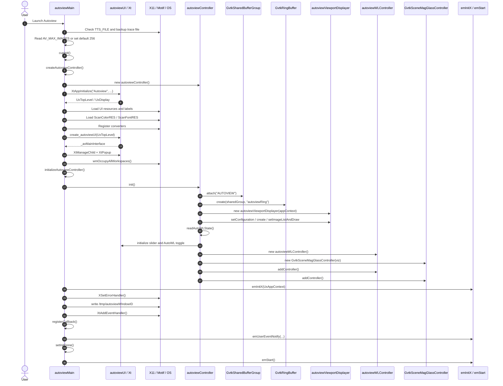

---

## 2) Shared buffer image update sequence

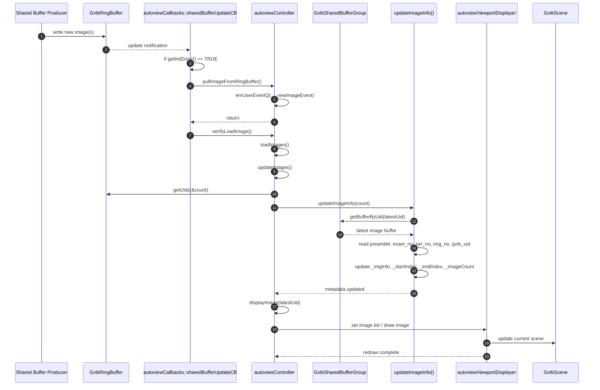

---

## 3) Autoview toggle sequence

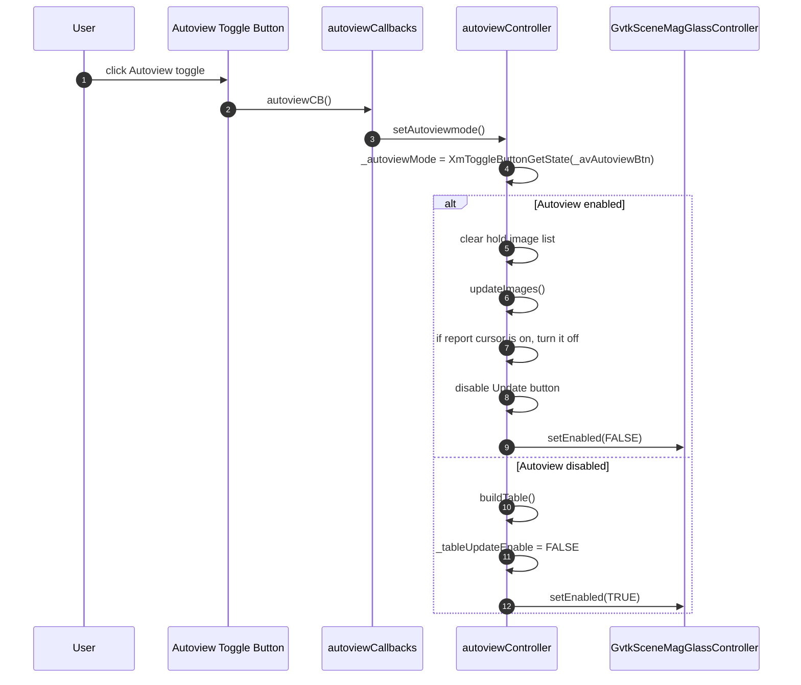

---

## 4) Report cursor toggle sequence

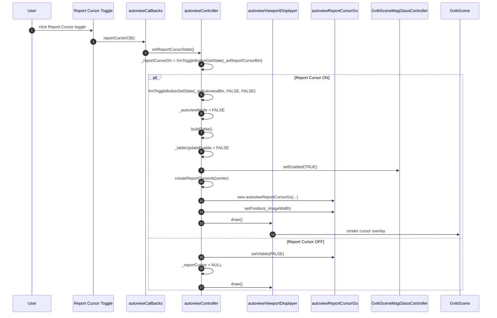

---

## 5) Auto WL toggle sequence

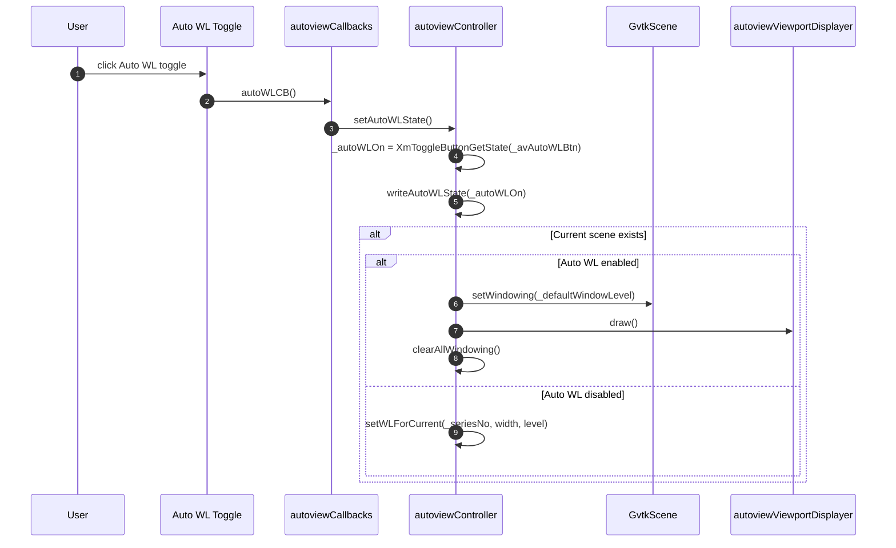

---

## 6) Scrollbar image selection sequence

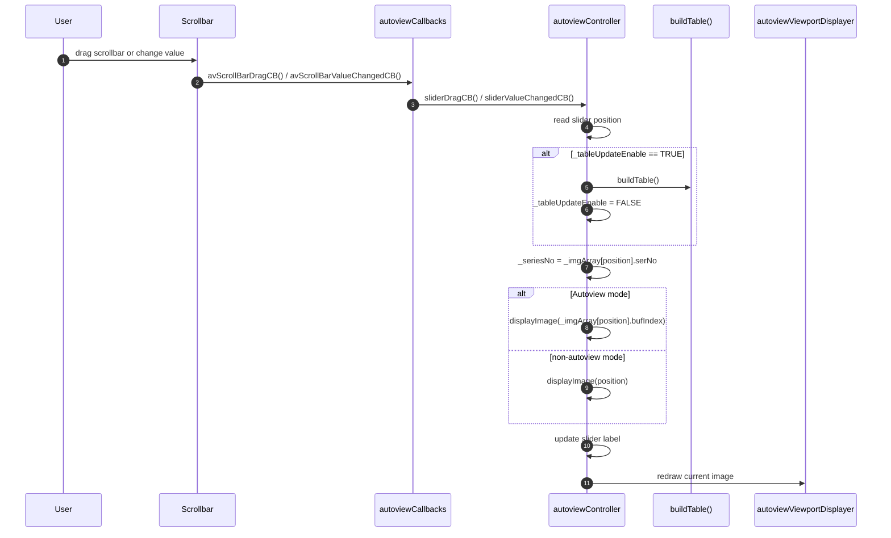

---

## 7) Page Up on viewport sequence

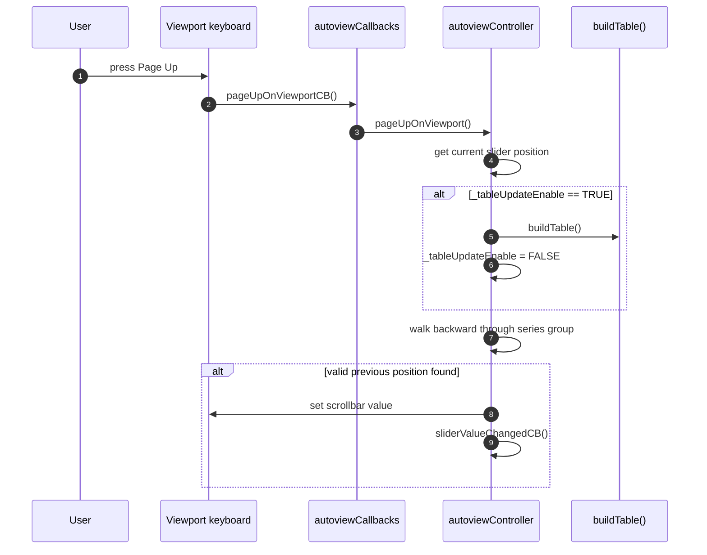

---

## 8) Page Down on viewport sequence

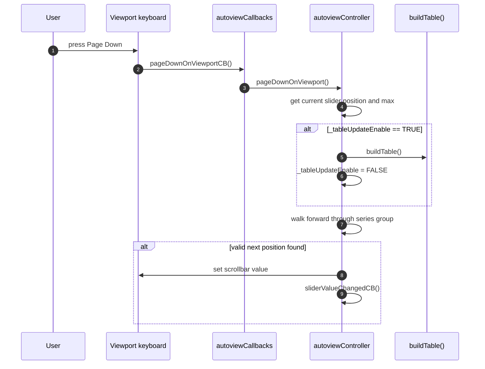

---

## 9) Up / Down key sequence

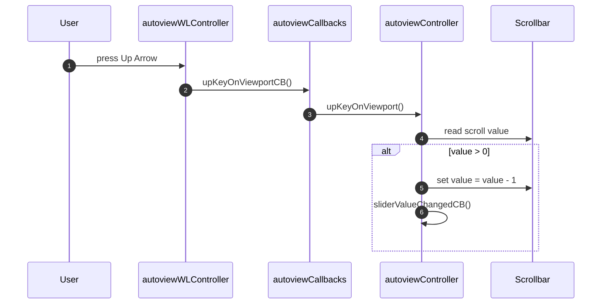

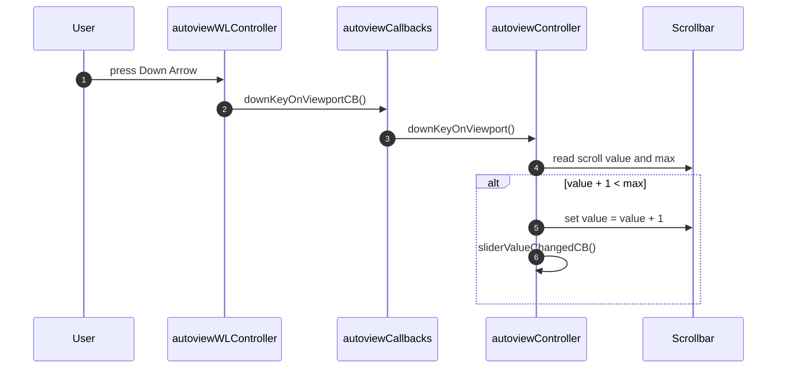

---

## 10) Mouse window / level adjustment sequence

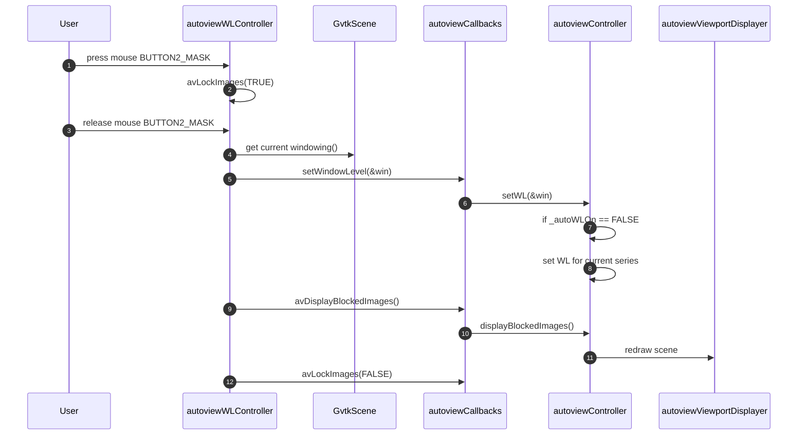

---

## 11) Mouse button 1 turns off Autoview

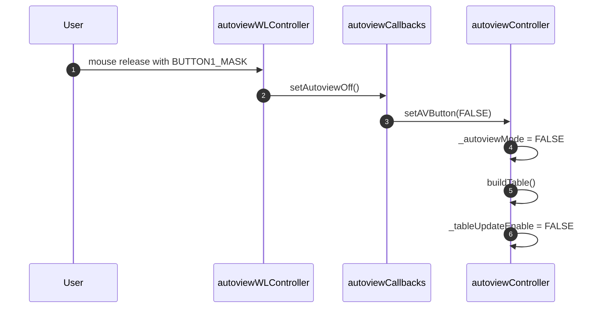

---

## 12) Desktop move / maximize / minimize sequence

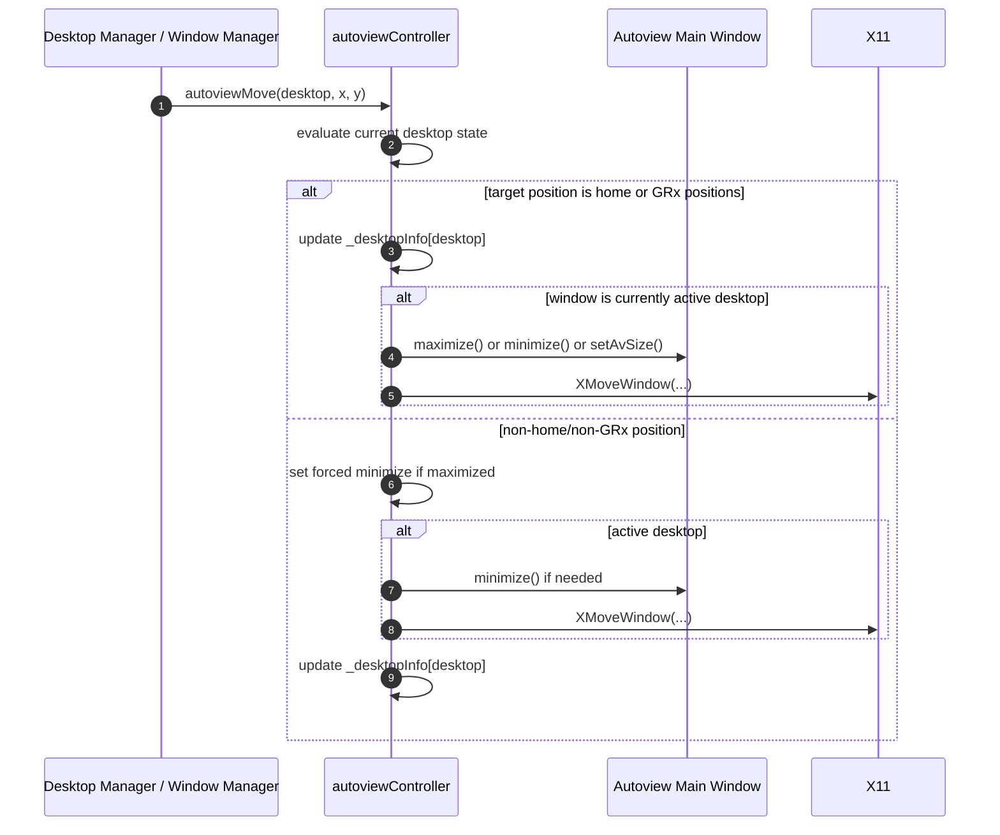

---

## 13) Auto WL state persistence sequence

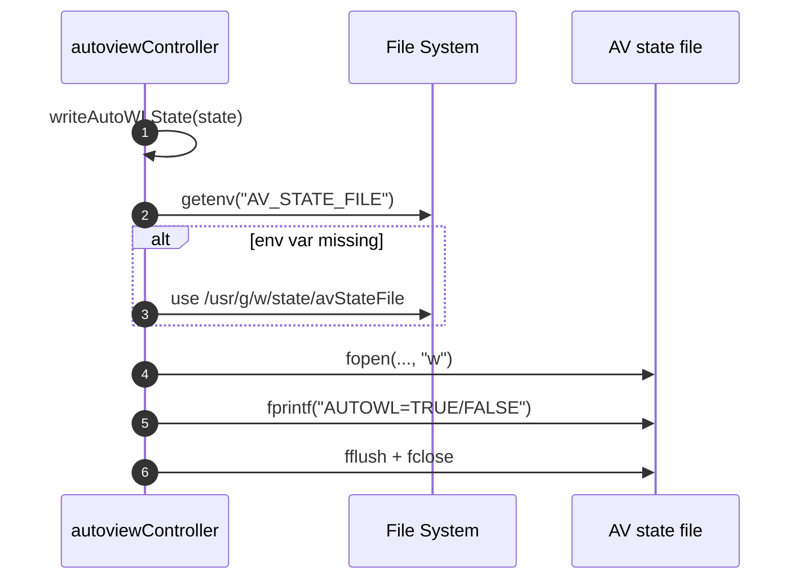

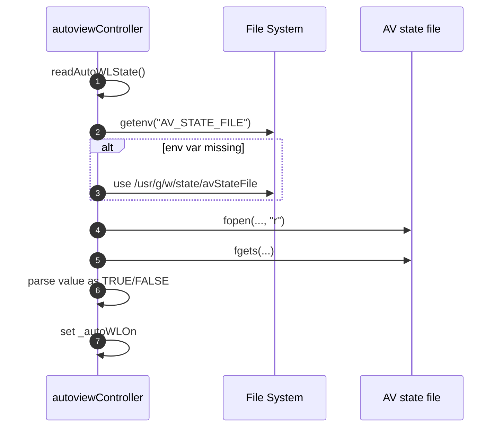

---

## Notes

- These diagrams reflect the runtime behavior implemented in the Autoview project files.
- The sequences are intentionally split by feature, so each diagram represents one specific flow.
- Mermaid is supported in many Markdown renderers and GitHub viewers, making this file suitable for review and download.
