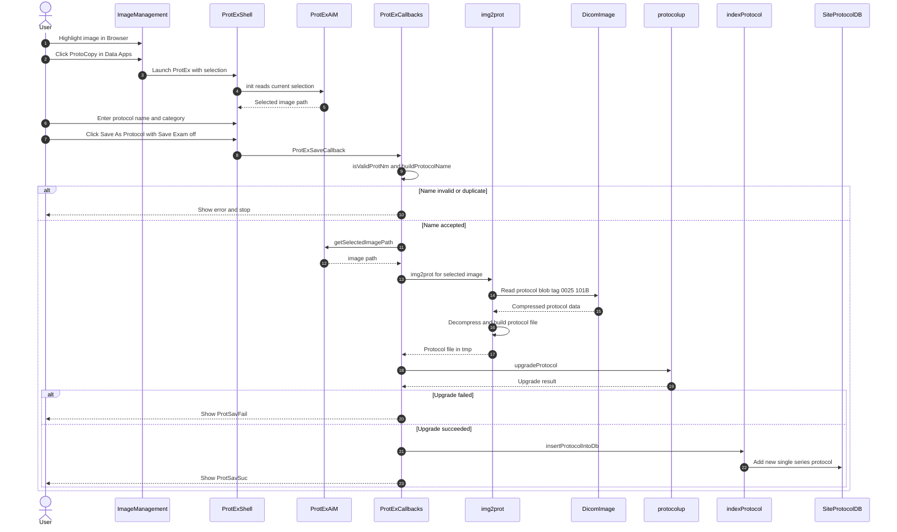
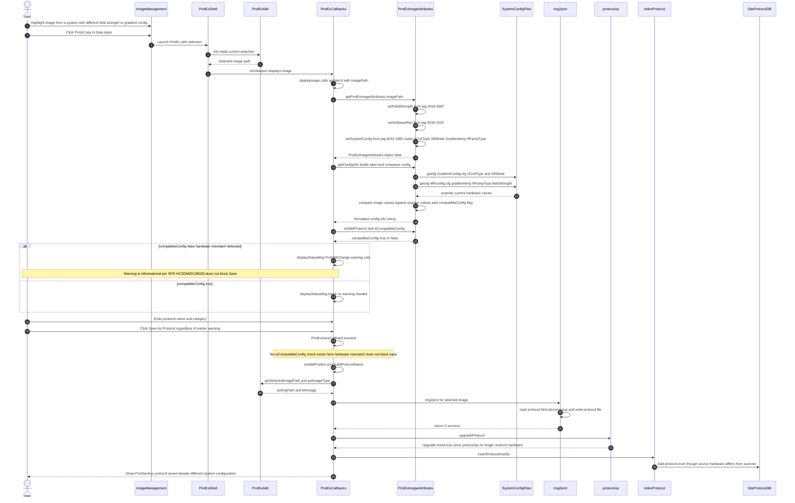
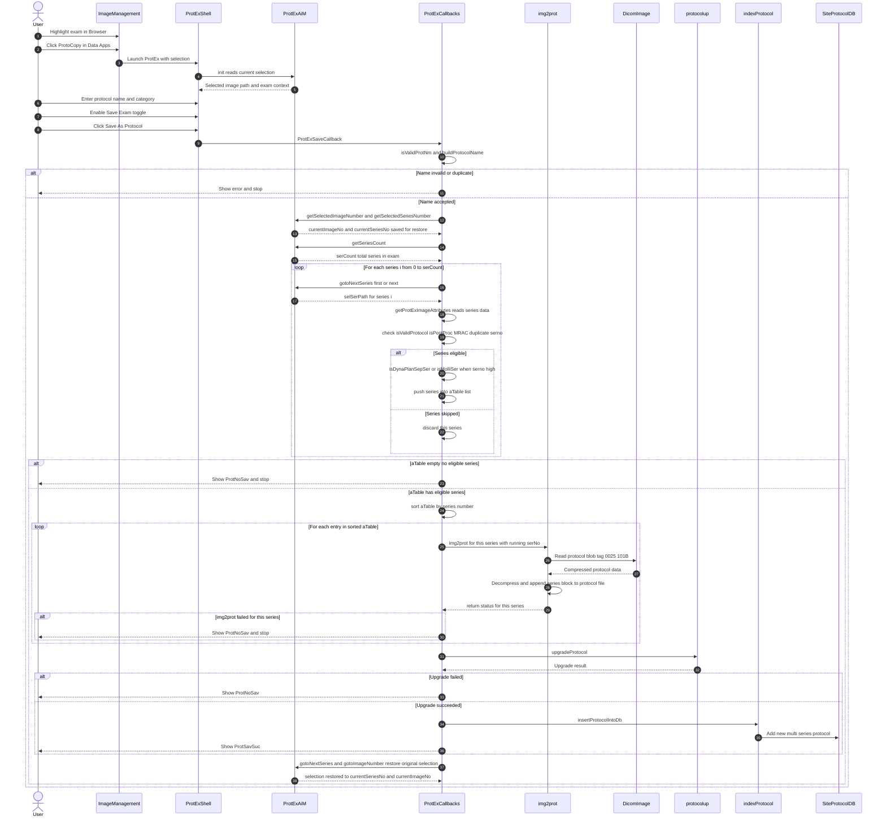

# Component Overview 
ProtoCopy (Protocol Copy Tool, binary ProtEx) is an MR Scan software component launched from the Data Apps menu in Image Management.

It lets a user create a new site protocol from a previously scanned exam, without re-entering scan parameters manually, and publishes the result into the site protocol library.

## Launch and Input Selection
The user first selects an item in the Image Browser — this can be an entire exam, a single series, or a single image within a series — and then opens ProtoCopy from Data Apps. 
ProtoCopy loads the corresponding exam/series/image into its own image viewer window regardless of which granularity was selected.

## Protocol Creation Modes
ProtoCopy supports two save modes, controlled by the Save Exam checkbox:

In other words, the Save Exam checkbox — not the original Image Browser selection — determines 
whether the output protocol is a single-task or an all-series (multi-task) protocol.

## Protocol Metadata and Save Workflow
Before saving, the user:

1. Selects the required anatomy category.

2. Enters a protocol name.

3. Clicks Save As Protocol (optionally after checking Save Exam).

On success, ProtoCopy displays a "Protocol Save Successful" message in the ProtoCopy window, and the protocol is written into the local site protocol library.

## Version Upgrade
As part of the save pipeline, ProtoCopy runs protocolup, which automatically upgrades any protocol authored under an older MR_VERSION to the current system's release (e.g., upgrading to MR30.0#2) so the saved protocol is compatible with the local scanner's software baseline.

## Cross-Hardware Support
Because the source exam may have been scanned on a GE MR system with a different hardware configuration (field strength, gradient/coil setup) than the system running ProtoCopy, a hardware-mismatch advisory message may be shown; this is informational only (post–SPR HCSDM00138028) and does not block the save.

# References:

# Requirements:
Requirement1:  The protocol copy feature shall copy the scan parameters from the highlighted image in the Browser to a new protocol in the site library.

Requirement2: The protocol copy feature shall only copy the protocol when the field strength and gradient slew rates match between the image and the scanner performing the copy.

SPR (New Feature): HCSDM00138028 WF-enh. Protocopy should support different system configurations

Requirement3: The protocol copy feature shall have the ability to create a multi-series protocol by selecting an exam in the image browser before requesting the protocol copy.

# Source/Binaries:

# Functionalities 

 

# Dependency

# System use cases:

# High-Level Flow Diagram

# FlowChart_Protocopy_WorkFlow_MR_Protocols:

# Class Diagrams

```mermaid
classDiagram
    direction LR

    class ProtExMain {
        <<module>>
        +main(argc, argv) int
    }

    class UxCProtExShell {
        <<UI>>
        +create_ProtExShell() Widget
        +activateCB_prtclbtn()
        +activateCB_quitBtn()
        +activateCB_reloadBtn()
        +prtclnametext Widget
        +btnAllSeries Widget
        +status_bar Widget
    }

    class ProtExCallbacks {
        <<module>>
        -ImageDB ProtExAiM
        -ProtCategory int
        -ProtName String
        -ErrMsgBuf String
        +initViewport()
        +updateUI(imagePath)
        +displayImage(imagePath)
        +ProtocolNameCallback()
        +ProtocolCategorySelected(num)
        +ProtExSaveCallback()
        +buildProtocolName(path) int
        +isDupSerNo(table, serno) bool
        +isDynaPlanSepSer(path, data) bool
        +isMolliSer(path, data) bool
        +upgradeProtocol(protname, destDir) int
        +insertProtocolIntoDb(destDir) int
        +ProtExCloseCallback()
        -displayStatusMsg(msg)
    }

    class ProtExData {
        +serno int
        +selSerPath String
        +data ProtExImageAttributes
        +sortCriterion(p1, p2) bool
    }

    class ProtExAiM {
        -ImageDB Aselection
        -_ready bool
        -MxImage bool
        -curSerNo int
        -curImgNo int
        -seriesTable PathTable
        -imageTable PathTable
        +init()
        +refresh()
        +buildSeriesTable(path, type)
        +buildImageTable(path, type)
        +getSelectedImagePath() String
        +getSelectedSeriesNumber() int
        +getSeriesCount() int
        +getImageType() bool
        +setImageType(isMx)
        +gotoNextSeries(direction) String
        +gotoNextImage() String
        +gotoNextExam(direction) String
    }

    class ProtExImageAttributes {
        -validProtInfo bool
        -MxImage bool
        -FieldStrength String
        -SRMode String
        -GCoilType String
        -GradientAmp String
        -compatibleConfig bool
        -postProc bool
        -modality String
        -imageSet String
        +setFieldStrength(value)
        +setSystemConfig(value)
        +setSoftwareRev(value)
        +setPostProc(imageType)
        +getConfigInfo() String
        +isCompatibleConfig() bool
        +isValidProtocol() bool
        +isPostProc() bool
        +isMxImage() bool
        +getSRMode() int
        +getGCoilType() int
        +getFieldStrength() int
        +getModality() String
        +getImageSet() String
    }

    class ImageAttributeUtils {
        <<module>>
        +getProtExImageAttributes(imagePath) ProtExImageAttributes
        +isPETModality(modality) bool
        +isPETSeries(imagePath) bool
        +isPETModalityAllowed() bool
        +getDMFTagValue(imagePath, tag) DMFValue
    }

    class Img2Prot {
        <<module>>
        +img2prot(img, prot, isMx, serCnt, serNo, isPET) int
        +createLxProtocol() int
        +createMxProtocol() int
        +createPETProtocol() int
        -writeProtocolHeaderSection()
        -writeSeriesGlobalSection()
        -writeSeriesSetSection()
    }

    class SDCSelectionAPI {
        <<external>>
        +ASdCSelectionOpen()
        +ASdCPrimaryImage()
        +AinitCommunications()
    }

    class TerraDMF {
        <<external>>
        +DMFDicomFileItemTemplate
        +DMFItem.getValue(tag)
        +TerraBlob
    }

    class ScannerConfig {
        <<external>>
        +getcfg(MRconfig.cfg, fieldStrength)
        +getcfg(GradientConfig.cfg, SRMode)
        +getProductProperty(key)
    }

    class ProtocolLibraryTools {
        <<external>>
        +protexists
        +protocolup
        +indexProtocol
        +protocol.tmpl
    }

    ProtExMain --> UxCProtExShell : creates
    ProtExMain --> ProtExCallbacks : initViewport
    ProtExMain --> ScannerConfig : reads modalities
    UxCProtExShell --> ProtExCallbacks : invokes callbacks
    ProtExCallbacks *-- ProtExAiM : owns ImageDB
    ProtExCallbacks "1" o-- "0..*" ProtExData : Save Exam list
    ProtExData --> ProtExImageAttributes : holds
    ProtExCallbacks ..> ImageAttributeUtils : uses
    ImageAttributeUtils ..> ProtExImageAttributes : creates
    ProtExCallbacks ..> Img2Prot : converts
    ProtExCallbacks ..> ProtocolLibraryTools : check, upgrade, index
    ProtExAiM ..> SDCSelectionAPI : reads Browser selection
    ImageAttributeUtils ..> TerraDMF : reads DICOM tags
    ProtExImageAttributes ..> ScannerConfig : compares hardware
    Img2Prot ..> TerraDMF : reads 0025,101B
    Img2Prot ..> ImageAttributeUtils : header values
    Img2Prot ..> ProtocolLibraryTools : reads template
```

 ProtExMain.cc: starts the Xt application, creates the UI, initializes communications and the viewport, then runs the event loop.

 ProtExShell.cc: creates widgets and registers Xt callbacks. The Save button registration calls Wrap_activateCB_prtclbtn.

 ProtExCallbacks.cc: receives UI actions and controls validation, the Save-one-image/Save-Exam branch, conversion, upgrade, and indexing. it drives the save workflow (single image for R1, full exam loop for R3). For R2, it displays the advisory. A mismatch does not stop either save branch.

 ProtExAiM.cc: reads the current Image Management selection and provides image, series, and exam navigation. Simply, it resolves the selection and builds series or image tables.

 ProtExImageAttributes.cc: reads DICOM metadata and checks whether protocol data is present and whether a series is eligible. it supplies hardware/compatibility metadata used only for an advisory warning (R2, post-SPR) → Img2ProtEngine (img2prot.cc) extracts and writes the Tcl protocol file → protocolup/indexProtocol publish it into the Site Protocol Library.

 img2prot.cc: extracts the embedded protocol payload and rebuilds the protocol file.
 
## Requirement mapping for Class Diagram: 
 

# Sequence Diagrams:
## sceanario#1 -R1: Copy scan parameters from the highlighted image to a new site protocol

## sceanario#2   -R2: Hardware compatibility check / Copy only when field strength and gradient slew rate match

Note : Refer the SPR for the changes relates to this requirement: HCSDM00138028 WF-enh. Protocopy should support different system configurations

# Req2: A user can import/highlight an exam from a system with a different field strength or gradient configuration and successfully run ProtoCopy — 
ProtExSaveCallback() → img2prot() → upgradeProtocol() → insertProtocolIntoDb() all complete and the protocol lands in the site library (ProtSavSuc). 
The only trace of the original hardware-matching requirement is the non-blocking ProtHWChange status-bar message shown earlier by updateUI(), 
advising the user that some values may need manual optimization — exactly matching the SPR's intent to "support different system configurations" 
instead of refusing the copy.

ProtExImageAttributes (ProtExImageAttributes.cc) still computes a hardware-compatibility flag:
setFieldStrength()
setSystemConfig()
getConfigInfo()
isCompatibleConfig() 

ProtExSaveCallback() — the actual save/copy logic — never calls isCompatibleConfig() or getConfigInfo() at all.

Per the SPR description, protocolup (the external shell command invoked by upgradeProtocol()) also no longer restricts on hardware differences — 
this was removed on the backend side outside this source tree, consistent with "Removed restriction on hardware changes in ProtoCopy 
since protocolUp back-end no longer has any."

### Note: isCompatibleConfig() is not required to save a protocol. It only reports whether the source image's hardware configuration matches the local system.

In updateUI(), ProtoCopy uses that result to decide whether to display a status message. It does not stop the save.

When the user clicks Save As Protocol, ProtExSaveCallback() follows a separate path:

Validates the protocol name and checks for duplicates. Extracts protocol data using img2prot(). Calls upgradeProtocol(), which runs protocolup. 
Calls insertProtocolIntoDb() and displays the success message.

## sceanario#3  - Create a multi-series protocol from a selected exam

# Key difference R1 vs R2: 
R1 calls img2prot() once with serCnt=1, serNo=1 for the single highlighted image. 
R3 calls img2prot() once per eligible series in the exam, with serCnt=aTable.size() and serNo incrementing, 
so the same output file accumulates one block per series — producing a single multi-series protocol.

# WorkFlow
Single-series protocol
Select an exam, series, or image in Image Management and launch ProtoCopy. Enter a protocol name and anatomy, then select Save As Protocol. 
ProtoCopy creates a single-task protocol from the image displayed in its viewer.

Hardware compatibility
ProtoCopy checks the source image's hardware configuration against the local system and may display an advisory for a mismatch. 
The mismatch does not itself block saving; other validation and processing checks still apply.

Exam protocol
Select an exam, series, or image and launch ProtoCopy. Enter a name and anatomy, select Save Exam, then Save As Protocol. 
ProtoCopy creates a multi-task protocol from the exam's eligible series.

For both save modes, ProtoCopy runs protocolup and invokes indexing into the site protocol library. 
The success message alone does not confirm indexing succeeded because indexing failures are only logged.

# Appendix : Assumptions and open Questions 

 

 # other details for R2 (different system):
 
 
 
 

 

 # Online Call chain:
 Data Apps → main() → ProtExAiM::init() → initViewport() → updateUI()
  → getProtExImageAttributes() → getConfigInfo()          [R2 warning]
User clicks Save → ProtExSaveCallback()
  → isValidProtNm() → buildProtocolName() → protexists
  → Save Exam ON:  gotoNextSeries() loop → img2prot() per series      [R3]
  → Save Exam OFF: getSelectedImagePath() → img2prot() once           [R1]
  → upgradeProtocol() → protocolup
  → insertProtocolIntoDb() → indexProtocol → Site Protocol library

  # ******* My Questions ***********
In ImageManagement we select scanned image/Dicom Image from protocopy to create new protocol.
scenario:

By selecting Exam from ImageManagement-> save exam (on/enable/checking)->save as new protocol
By selecting Exam from ImageManagement-> Save Exam (off)-> save as new protocol
By selecting series from ImageManagement for existing Exam -> create new protocol
By selecting image from ImageManagement for existing Exam-> create new protocol
which are correct scenarios among 4?

Ans: All four can be valid, provided ProtoCopy resolves the Browser selection to an available image containing protocol data. 
The Save Exam checkbox, not just the Browser selection level, determines what gets saved.

# Key external interfaces involved
DICOM image payload: protocol blob in tag (0025,101B)

Product configuration checks: getcfg, system properties

Duplicate validation: /usr/g/bin/protexists

Protocol template: PROTOCOL_TEMPLATE_FILE or /usr/g/bin/protocol.tmpl

Compression helpers: gzip / gunzip

Protocol staging and upgrade: protocolup

Indexing into site library: /export/home/wfm/host/scripts/indexProtocol

Filesystem temp staging: tmp, /tmp/.fm, /tmp/protcpy

 

 

