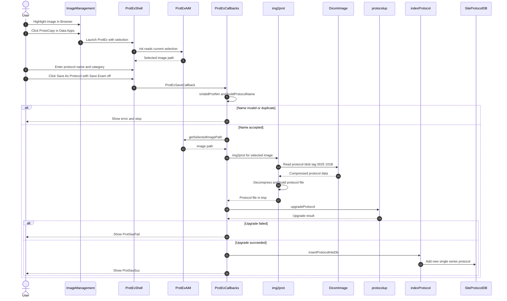
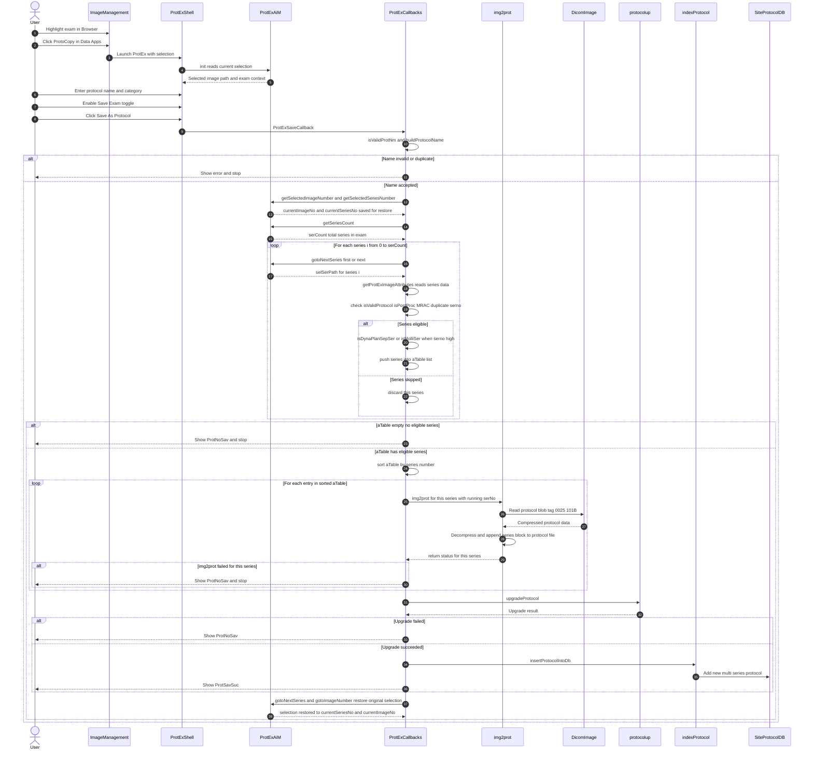

# Explanation about Protocopy: 
# Sequence Diagram :
## sceanario#1 -R1: Copy scan parameters from the highlighted image to a new site protocol

## 1) Explain above Sequence Diagram for R1 in lemon language using function call and class, on selecting exam from Image management, then launch protocopy from Data Apps, 
how function or class invokes to each other.
ProtEx is binary for debug, how can we debug to cover entire flow for R1?
Path: /c/uws/ms021387/mdmodabbir.raza_linux_Common_Raza_July_2026.07.06/scan/SrxProtocols

# one-line chain call:
main() → create_ProtExShell() → ProtExAiM::init() [ASdCSelectionOpen/ASdCPrimaryImage]
       → user clicks Save → ProtExSaveCallback()
       → isValidProtNm() → buildProtocolName()
       → ImageDB.getSelectedImagePath() → img2prot()
       → upgradeProtocol() → insertProtocolIntoDb() → displayStatusMsg()

# Debugging the full R1 flow with gdb
The practical issue: ProtEx needs a live $SDC_SELECTION_FILE from Image Management to have anything meaningful selected, 
so launching it standalone from a shell usually gives you an empty/garbage selection. 
The reliable way is to attach to the process after Data Apps launches it, not run it directly under gdb.

# 1. Launch ProtoCopy normally: Image Management -> select exam -> Data Apps -> ProtoCopy
# 2. Find the running process
ps -ef | grep ProtEx

# 3. Attach gdb to it
gdb -p <pid>

or 
on launch protocopy:
open terminal (ms021387->Rhino (10.20.86.80) ->coral (target system ip)) -> gdb -p `pgrep ProtEx`
break ProtExAiM::init
break ProtExSaveCallback
break isValidProtNm
break buildProtocolName
break img2prot
break upgradeProtocol
break insertProtocolIntoDb
continue

img2prot(...) == 0
  -> "ProtSavWait"
  -> convertNameToFileName(ProtName, protname)
  -> upgradeProtocol(protname, "/tmp/protcpy")
       -> mkdir /tmp/protcpy if missing
       -> system("protocolup -s -a <anatomy> -f /tmp/<protname> -m /tmp/protcpy")
  -> if true: insertProtocolIntoDb("/tmp/protcpy")
       -> system("/export/home/wfm/host/scripts/indexProtocol /tmp/protcpy >& /usr/g/service/log/indexProtocol.out")
       -> rm -rf /tmp/protcpy
  -> "ProtSavSuc" shown in status bar

  So end to end for a plain Lx scanned image: highlight image → ProtoCopy reads it via ImageDB → 
  img2prot/createLxProtocol turns the DICOM protocol blob into a series1 Tcl protocol file at /tmp/<name> → 
  protocolup adapts/stages it under /tmp/protcpy → indexProtocol publishes it into Site Protocols, logging to /usr/g/service/log/indexProtocol.out.

  
  

# sceanario#3  - Create a multi-series protocol from a selected exam

Key contrast vs R1: R1 calls img2prot() once with serCnt=1, serNo=1 for the single highlighted image. 
R3 calls img2prot() once per eligible series in the exam, with serCnt=aTable.size() and serNo incrementing, 
so the same output file accumulates one proc series<N> {} block per series — producing a single multi-series protocol.

# Req2:

## Flow Summary
Flow summary: User highlights content in the Browser and invokes ProtoCopy → ProtExAiM resolves the selection and builds series or image tables → 
ProtExCallbacks drives the save workflow (single image for R1, full exam loop for R3) → 
ProtExImageAttributes supplies hardware/compatibility metadata used only for an advisory warning (R2, post-SPR) → 
Img2ProtEngine (img2prot.cc) extracts and writes the Tcl protocol file → protocolup/indexProtocol publish it into the Site Protocol Library.

R1: Single-series protocol
Select an exam, series, or image in Image Management and launch ProtoCopy. Enter a protocol name and anatomy, then select Save As Protocol. 
ProtoCopy creates a single-task protocol from the image displayed in its viewer.

R2: Hardware compatibility
ProtoCopy checks the source image's hardware configuration against the local system and may display an advisory for a mismatch. 
The mismatch does not itself block saving; other validation and processing checks still apply.

R3: Exam protocol
Select an exam, series, or image and launch ProtoCopy. Enter a name and anatomy, select Save Exam, then Save As Protocol. 
ProtoCopy creates a multi-task protocol from the exam's eligible series.

For both save modes, ProtoCopy runs protocolup and invokes indexing into the site protocol library. 
The success message alone does not confirm indexing succeeded because indexing failures are only logged.

# Requirement to design Mapping:

## Are we runing script externally:
They run automatically as part of ProtoCopy’s Save As Protocol flow; the user does not run them manually.
After extracting the protocol data, ProtoCopy calls upgradeProtocol(), which invokes protocolup through system(). 
If that succeeds, the save callback calls insertProtocolIntoDb(), which invokes the indexProtocol script to add the upgraded protocol to the site library. 
This applies to both single-task saves (R1) and Save Exam saves (R3).

## These are parts of the legacy X11 user-interface stack ProtoCopy uses:
-> X11 is the windowing system. It provides the mechanism for applications to create windows and communicate with the display server.

-> Xt (X Toolkit Intrinsics) is a toolkit layer built on X11. It provides application initialization, widget management, and the event loop.

-> Motif is a widget toolkit built on Xt. ProtoCopy uses Motif widgets such as the file-selection box and uses Xm... functions to configure them.

-> XtAppInitialize() initializes Xt for the application and creates the top-level shell. In ProtExMain.cc, its result is stored in UxTopLevel; 
   ProtoCopy then creates its interface and eventually runs XtAppMainLoop() to process UI events.

-> swidget is a type used by the generated Ux interface code for a widget/interface handle. It appears in declarations such as create_ProtExShell(swidget). 
   Its exact typedef is in the Ux support headers, such as UxXt.h.

-> xtmain.dat is referenced in a comment in ProtExMain.cc: it configures the generated main program’s default interface identifier, mainIface. 
   The comment suggests it is an input to the UI code-generation setup, not a file ProtoCopy reads as runtime data. The actual generated program source is ProtExMain.cc.

-> A useful mental model is: X11 provides the display foundation → Xt manages the application and event loop → 
   Motif supplies the UI widgets → Ux-generated code assembles ProtoCopy’s interface.

### GVtk is the GE visualization toolkit used here to load and render the selected medical image in ProtoCopy’s viewer. In this code, it is the display layer, 
not the part that selects the exam or extracts the protocol.

The flow in initViewport() is:
ImageDB.getSelectedImagePath() gets the selected image path through ProtoCopy’s AiM/SDC selection wrapper.
GvtkGeMedicalFileImageProvider loads that file and returns a GvtkImageList.
GVtk creates a GvtkScene for the image and a GvtkVisualizer to display it.
GvtkViewportDisplayer draws the image inside the Motif ViewPortForm window.
When the displayed image changes, displayImage() uses the provider and viewport displayer to show the new image.

So: AiM/SDC identifies the selected image; GVtk displays it; Terra DMF and img2prot() read and convert its protocol data.

{sdc@CORAL}[114] ps -aef | grep -i ProtEx
sdc      19810 14080  0 12:59 pts/2    00:00:00 grep -i ProtEx
{sdc@CORAL}[115] tail -f /usr/tmp/sdc_selection
Coral->select Highlighted image->click on protocopy from DataApps->
ps -aef | grep ProtEX
{sdc@CORAL}[111] ps -aef | grep ProtEx
sdc      26290 26287  0 15:47 ?        00:00:00 /usr/bin/perl /export/home/sdc/nuevo/scripts/util/launchAppAndGetPid.pl /usr/tmp/sdc_selection browser.ProtoCopy345407998 /usr/g/bin/ProtEx SDC_SELECTION_FILE=/usr/tmp/sdc_selection

sdc      26292 26290  3 15:47 ?        00:00:00 /usr/g/bin/ProtEx SDC_SELECTION_FILE=/usr/tmp/sdc_selection
sdc      26659 23777  0 15:47 pts/5    00:00:00 grep ProtEx
->Whenever we select highlighted image then it stores/updated in /usr/g/bin/ProtEx SDC_SELECTION_FILE=/usr/tmp/sdc_selection

2nd)
{sdc@CORAL}[118] lsof -p 26292

ProtEx  26292  sdc   2w   REG               0,37        65    40790 /tmp/viewer.console.out

Cd /tmp
-rw-rw-r-- 1 sdc           informix          79768 Nov 11 16:20 RAZA_new1
drwxrwxr-x 3 sdc           informix             60 Nov 11 16:20 tmp/
-rw-rw-r-- 1 sdc           informix           3642 Nov 11 16:20 protocolUP_log.txt.0
-rw-rw-r-- 1 sdc           informix            140 Nov 11 16:20 protocolconvert.log
-rw-rw-r-- 1 sdc           informix         893626 Nov 11 16:20 protocolup_postDVMR.log.0
-rw-rw-r-- 1 sdc           informix           7269 Nov 11 16:20 protocolup.log.0
-r--r--r-- 1 sdc           informix           4556 Nov 11 16:20 protocol_upgrade.properties
-rw-rw-r-- 1 sdc           informix           2123 Nov 11 16:20 viewer.console.out
-r--r--r-- 1 sdc           informix           1533 Nov 11 16:20 TaskTemplate.xml
-r--r--r-- 1 sdc           informix           3388 Nov 11 16:20 SessionTemplate.xml
-rw-rw-r-- 1 sdc           informix              0 Nov 11 16:20 prot.out
-rw-rw-r-- 1 sdc           informix            134 Nov 11 16:20 protocolupgrade.log
//after launch Protocopy, on save as protocol on Protcol Copy Tool window
{sdc@CORAL}[114] tail -f viewer.console.out
glx: failed to create dri3 screen
failed to load driver: nouveau
rm: cannot remove '/tmp/.fm/*': No such file or directory
Corrected anatomyToCheck=head, protToCheck=hhhhpr
-s -a head -f /tmp/hhhhpr -m /tmp/protcpy --
ProtocolConversion Started...............
Log created in /tmp
ProtocolConversion Completed...............
protocolconv completed with exit status: 0
ProtocolUpgrade Started...............
Log created in /tmp
/tmp/protupMxESErearch.sh.MxProtocol.filelist.31251
ProtocolUpgrade Completed.............

# Code Flow:
In Image-Management/Image Browser, launch protocopy/ protocol copy tool from DataApps launcher, then OS loads /usr/g/bin/ProtEx and runs it's main( ) in ProtExMain.cc:68.
1. ProtExMain.cc 
#include <X11/Intrinsic.h>
#include <X11/StringDefs.h>
#include <X11/Xlib.h>
#include <Xm/FileSB.h>
#include <Xm/Xm.h>
#include <Xm/MwmUtil.h>
#include "colors.h"
#include "fonts.h"
#include "AiM/AiM_service.h"

#include "ge_i18n.h" /* Multibyte Support */
/*-------------------------------------------------- 
 * UxXt.h needs to be included only when compiling
 * a stand-alone application. 
 *-------------------------------------------------*/
#ifndef DESIGN_TIME
#include "UxXt.h"
#endif /* DESIGN_TIME */

#define PROTEX_APPNAME "ProtEx"

XtAppContext	UxAppContext = NULL;
Widget		UxTopLevel = NULL;
Display		*UxDisplay = NULL;
int		UxScreen = 0;
char allowedModalities[64] = {0};
#ifdef UX_CATALOG
nl_catd		UxMsgCatalog;
#endif /* UX_CATALOG */

extern "C"
{
	int GeXLoadResources(Display*,char*,char*);
	int GeXSetInvalid(Widget,Boolean);
	void ScanRegisterPixelConverter();
	void ScanRegisterFontListConverter();
    int InitializeLabels(const char *);
    char *getProductProperty(const char* keyName);    
}

extern void initViewport();

/*----------------------------------------------
 * Insert application global declarations here
 *---------------------------------------------*/

#ifdef _NO_PROTO
int	main(argc,argv)
	int	argc;
	char	*argv[];
#else
int	main(int argc, char *argv[])
#endif /* _NO_PROTO */
{

/*---------------------------------
	 * Interface function declaration
	 *--------------------------------*/	

	Widget  create_ProtExShell(swidget);
	Widget  create_CdDvdFileSel(swidget);

	swidget UxParent = NULL;

   /*
     * Read MWL.StartExam.AllowedModalities to check if PET specific modalities are allowed in 
     * protocopy OR not.
     */
	modalities = getProductProperty("MWL.StartExam.AllowedModalities");
  initViewport(); // calls to 

	/*-----------------------
	 * Enter the event loop 
	 *----------------------*/

	XtAppMainLoop(UxAppContext);
  }

2) ProtExCallbacks.cc

/* Initializes ProtEx Application Viewport */
void initViewport()
{
    char *selImgPath = NULL;

    ac = new GvtkX11ApplicationContext(ViewPortForm);
    viewportDisp = new GvtkViewportDisplayer(ac);
    window = GvtkX11ApplicationContext::wrapWidget(ViewPortForm);
    GvtkCursor::getStandardCursor(ac).setCursor();
    viewportDisp->setConfiguration(0, 0, 512, 512);
    window.setSize(GvtkDimensions2d(512, 512));
    viewportDisp->setRows(0);
    viewportDisp->setColumns(0);
    viewportDisp->create(window);
    viewportDisp->setSceneCreator(new GvtkIosImageSceneCreator(ac));
    imageFile =  new GvtkGeMedicalFileImageProvider();

    selImgPath = ImageDB.getSelectedImagePath();
    if( selImgPath != NULL ) {
        imageFile->addFile(selImgPath);
        imgList = imageFile->getImageList();
        if(imgList == NULL)
            printf("PROT_EX::The Image List is empty");
        GvtkImage* image1 = imgList->imageAt(0);
        GvtkScene* scene = new GvtkScene(image1);
        GvtkVisualizer visualizer(ac, 0);
        visualizer.setPosition(GvtkPoint2d(5, 5));
        visualizer.setSize(GvtkDimensions2d(512, 512));
        visualizer.associate(scene);
        visualizer.setVisible(true);
        viewportDisp->setImageListAndDraw(imgList);
        updateUI(selImgPath);
        free(selImgPath);
    }
    else {
        printf("PROT_EX::Couldn't find the currently selected Image\n");
    }
}

3) ProtExAim.cc
   /* Initialize Routine */
void ProtExAiM::init() {
    ImageDB = (Aselection)NULL;
    _ready = false;
    MxImage = false;
    curSerNo = 0;
    curImgNo = 0;
    seriesTable.clear();
    imageTable.clear();

    /* Open $SDC_SELECTION_FILE */
    if( (ImageDB = ASdCSelectionOpen()) != (Aselection)NULL) {
        char imagePath[MAXPATHLEN] = { 0 };
	int  curSelIndex = 0;
	/* Find currently selected image */
        if( ASdCPrimaryImage(ImageDB, imagePath, &curSelIndex) == 0) {
	    /* Update internal data structures */
	    buildSeriesTable(imagePath, IMAGE_PATH);
	    buildImageTable(imagePath, IMAGE_PATH);
	    char *serno = AgetSeriesNumber(imagePath);
	    if( serno != NULL ) {
	        curSerNo = atoi(serno);
		free(serno);
	    }
	    char *imgno = AgetImageNumber(imagePath);
	    if( imgno != NULL ) {
	        curImgNo = atoi(imgno);
		free(imgno);
	    }
	    /* Keep pointer ready for exam traversal */
	    ASdCSelectionSeek(ImageDB, Aselection_level_ex, 0, Aselection_ptrname_first);
            _ready = true;
	}
    }
}

/* Returns the path for currently selected image in the viewport */
char* ProtExAiM::getSelectedImagePath() {
    if( _ready ) {
        PathTable::iterator ptr = imageTable.find(curImgNo);
        if( ptr != imageTable.end() )
            return strdup(((*ptr).second).c_str());
    }
    return NULL;
}

/* Callback for Save Protocol button */
void ProtExSaveCallback(Widget wgt, XtPointer xptr, XtPointer eventData) {
	printf("PROT_EX::Save Button Pressed...\n");

	// Clean the .fm directory before we start
	system("exec rm -r /tmp/.fm/*");

	extern Widget btnAllSeries;
	char protPathName[MAXPATHLEN] = { 0 };
	char protname[MAXPATHLEN] = { 0 };
	int status = -1;
	int i = 0;
	int serno = 0;
	ProtExData *aData = NULL;
	vector<ProtExData> aTable;
	vector<ProtExData>::iterator anIt;

	/* do the same check for protocol name which we do at the time of saving
	   protocol from scan/protocol desktop */
	if(isValidProtNm(ProtName) == FALSE)
	{
		strncpy(ErrMsgBuf, "Invalid protocol name entered. A protocol name\ncannot be all spaces or numeric characters.", 255);
		ErrMsgBuf[255] = '\0';
		displayStatusMsg(ErrMsgBuf);
		return;
	}

	status = buildProtocolName(protPathName);
	if( status == -1 ) {
		strcpy(ErrMsgBuf, (char*)GetLabelString("ProtAlExists"));
		displayStatusMsg(ErrMsgBuf);
		return;
	}

	bool saveall = XmToggleButtonGetState(btnAllSeries);
	if(saveall == TRUE)
	{
		int currentImageNo = ImageDB.getSelectedImageNumber();
		int currentSeriesNo = ImageDB.getSelectedSeriesNumber();

		char *selSerPath = NULL;
		int serCount = ImageDB.getSeriesCount();
		int prevSerNo = -1;

		strcpy(ErrMsgBuf, (char*)GetLabelString("ProtSavWait"));
		displayStatusMsg(ErrMsgBuf);

		for(i = 0; i < serCount; i++) {
			if( i == 0 )
				selSerPath = ImageDB.gotoNextSeries(0);
			else
				selSerPath = ImageDB.gotoNextSeries(1);

			if(selSerPath == NULL) {
				printf("PROT_EX::Couldn't get selected image path\n");
				return;
			}

			ProtExImageAttributes* data = getProtExImageAttributes(selSerPath);
			int serno = ImageDB.getSelectedSeriesNumber();

			if(data->isValidProtocol() && 
                    isPETModality(data->getModality()) &&
                    (!isPETModalityAllowed() ||
					  isPETProtocolAlreadyProcessed(aTable, data))){
				delete data;
				continue;
			}

			if ( !data->isValidProtocol() || data->isPostProc() ||
					strncmp(data->getImageSet(), "MRAC", 4) == 0 ||
					(!isPETModality(data->getModality()) && (serno >= 99) &&
					 (isDupSerNo(aTable, (serno / 100)) ||
					  (!isDynaPlanSepSer(selSerPath, data) && !isMolliSer(selSerPath, data)) )))
			{
				delete data;
			}
			else
			{
				aData = new ProtExData();
				aData->data = data;
				aData->selSerPath = selSerPath;
				if (serno < 100)
					aData->serno = serno;
				else
					aData->serno = isPETModality(data->getModality())?serno:serno / 100;
				aTable.push_back(*aData);
			}
			prevSerNo = serno;

		}

        if(aTable.size() == 0){
            strcpy(ErrMsgBuf, (char*)GetLabelString("ProtNoSav"));
            displayStatusMsg(ErrMsgBuf);
            printf("\n PROT_EX:: Failed to create Protocol from Image for whole Exam\n");
            return;
        }

		std::sort(aTable.begin(), aTable.end(), ProtExData::sortCriterion);

		for (anIt = aTable.begin(), serno=1; anIt < aTable.end(); anIt++, serno++) {
			/* Extract protocol from image */
			if( img2prot(anIt->selSerPath, protPathName,
						anIt->data->isMxImage(), aTable.size(), serno, isPETModality(anIt->data->getModality())) != 0) {
				strcpy(ErrMsgBuf, (char*)GetLabelString("ProtNoSav"));
				displayStatusMsg(ErrMsgBuf);
				printf("PROT_EX:: Failed to create Protocol from Image for whole Exam\n");
				delete anIt->data;
				free(anIt->selSerPath);
				unlink(protPathName);
				return;
			}
			delete anIt->data;
			free(anIt->selSerPath);
		}
		aTable.clear();

		convertNameToFileName(ProtName, protname, sizeof(protname));

        if (upgradeProtocol(protname, (char *)TMP_WORKING_DIR) == true){
            insertProtocolIntoDb((char *)TMP_WORKING_DIR);
            strcpy(ErrMsgBuf, (char*)GetLabelString("ProtSavSuc"));
        }
        else{
            strcpy(ErrMsgBuf, (char*)GetLabelString("ProtNoSav"));
        }

		displayStatusMsg(ErrMsgBuf);

		ImageDB.gotoNextSeries(0);
		for(int j = 1; j < currentSeriesNo; j++) 
		{
			ImageDB.gotoNextSeries(1);
		}
		ImageDB.gotoImageNumber(currentImageNo);
	}
	else {
		char *selImgPath = ImageDB.getSelectedImagePath();
		bool MxImage = ImageDB.getImageType();
		if( selImgPath == NULL ) {
			printf("PROT_EX::Couldn't get selected image path\n");
			return;
		}

		bool isPET = isPETSeries(selImgPath);

        if( isPET && !isPETModalityAllowed() ){
            strcpy(ErrMsgBuf, (char*)GetLabelString("ProtSavFail"));
            displayStatusMsg(ErrMsgBuf);
            printf("PROT_EX:: Failed to create Protocol from Image\n");
            free(selImgPath);
            return;
        }

		/* Extract protocol from image */
        if( img2prot(selImgPath, protPathName, MxImage, 1, 1, isPET) == 0) {
            strcpy(ErrMsgBuf, (char*)GetLabelString("ProtSavWait"));
            displayStatusMsg(ErrMsgBuf);

            convertNameToFileName(ProtName, protname, sizeof(protname));

            if( upgradeProtocol(protname, (char *)TMP_WORKING_DIR) == true ){
                insertProtocolIntoDb((char *)TMP_WORKING_DIR);
            }
            else{
                strcpy(ErrMsgBuf, (char*)GetLabelString("ProtSavFail"));
                displayStatusMsg(ErrMsgBuf);
                printf("PROT_EX:: Failed to create Protocol from Image\n");
                free(selImgPath);
                return;
            }
            strcpy(ErrMsgBuf, (char*)GetLabelString("ProtSavSuc"));
            displayStatusMsg(ErrMsgBuf);
        }
		else {
			strcpy(ErrMsgBuf, (char*)GetLabelString("ProtSavFail"));
			displayStatusMsg(ErrMsgBuf);
			printf("PROT_EX:: Failed to create Protocol from Image\n");
		}
		free(selImgPath);
	}
}

Note: As Interview Point, I can explain extern, STL, API which have I used:
1) what is and what does extern "C" does in .cc file? 
  -> In C++, extern "C" is used to tell the C++ compiler that the enclosed functions or variables use C linkage instead of C++ linkage.
  -> C++ supports function overloading, namespaces, classes, etc. To implement these features, the compiler performs name mangling (changes function names internally).
  -> extern "C" is used in C++ source files (.cc, .cpp) to disable C++ name mangling and use C linkage. It enables C++ code to call functions compiled by a C compiler and        is commonly used in header files shared between C and C++ codebases.
  //extra points:
Name mangling is the process by which a C++ compiler changes a function or variable name into a unique internal name so it can support features like:
	• Function overloading
	• Namespaces
	• Classes
	• Templates
	1) Ex:

void print(int);
void print(double);
Both functions have the same name (print) but different parameter types.
C does not support this. So the compiler generates unique names internally:

print(int)      -> _Z5printi
print(double)   -> _Z5printd

(The exact mangled names depend on the compiler.)
This transformation is called name mangling.

   

